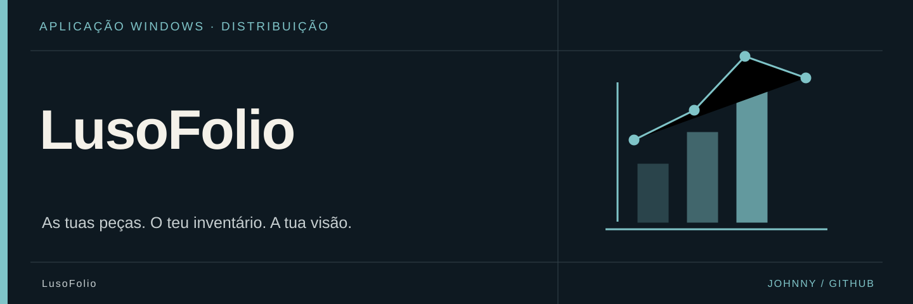

<p align="center">
  
</p>

# 💼 LusoFolio 0.2.1

LusoFolio é uma aplicação Windows para acompanhar compras, vendas, inventário e desempenho de um portefólio CS2 no CSFloat.

O repositório disponibiliza apenas o instalador público da aplicação e este README. O código-fonte e os dados locais dos utilizadores não fazem parte desta publicação.

<a name="instalação"></a>

## 📦 Instalação

1. Descarrega o [instalador Windows 0.2.1](https://github.com/Johnnyzao/LusoFolio/raw/refs/heads/main/LusoFolio_0.2.1_x64-setup.exe).
2. Confirma a origem e o SHA-256 indicado abaixo.
3. Executa o instalador depois dessa verificação.
4. Abre o LusoFolio e conclui a configuração inicial.

<a name="configuração-inicial"></a>

## ⚙️ Configuração inicial

Cada utilizador deve configurar os seus próprios dados:

- **API key pessoal do CSFloat**: pode ser criada no perfil CSFloat, no separador **Developer**.
- **SteamID64**: identificador Steam composto por 17 algarismos.

A API key permite consultar informação privada da conta CSFloat. Não deve ser partilhada, publicada ou enviada a terceiros.

O SteamID64, por si só, pode identificar o perfil Steam e listings públicos, mas não permite aceder ao histórico privado de compras e vendas.

<a name="sincronização"></a>

## 🔄 Sincronização

- Ao iniciar, o LusoFolio procura actividade recente automaticamente.
- Enquanto estiver aberto, actualiza os dados recentes a cada 15 minutos.
- O botão **Actualizar** força uma actualização imediata.
- A opção **Sincronização completa**, disponível nas definições, volta a importar todo o histórico CSFloat.

<a name="privacidade"></a>

## 🔐 Privacidade

- A base de dados e a configuração ficam guardadas localmente no computador.
- Cada instalação mantém os seus próprios dados.
- O LusoFolio não tem servidor próprio e não envia a API key para terceiros.
- A API key é usada apenas para comunicar directamente com a API do CSFloat.

<a name="requisitos"></a>

## 💻 Requisitos

- Windows 10 ou Windows 11, 64 bits.
- Ligação à Internet.
- Conta CSFloat.

<a name="verificação-do-instalador"></a>

## 🔎 Verificação do instalador

SHA-256:

```text
CF02499224809055F94412EEB8BD73BA70FA463B9797782F607B72189F74165F
```

<a name="english"></a>

## 🌐 English

LusoFolio is a Windows application for tracking CS2 purchases, sales, inventory and portfolio performance on CSFloat.

Download `LusoFolio_0.2.1_x64-setup.exe`, run the installer and complete the initial setup with your own CSFloat API key and SteamID64.

The application stores its database and configuration locally. It does not operate its own server and does not send your API key to third parties.

<a name="contactos"></a>

## 🤝 Contactos

- GitHub: https://github.com/Johnnyzao
- Instagram: https://www.instagram.com/j0hnny._.zao/
