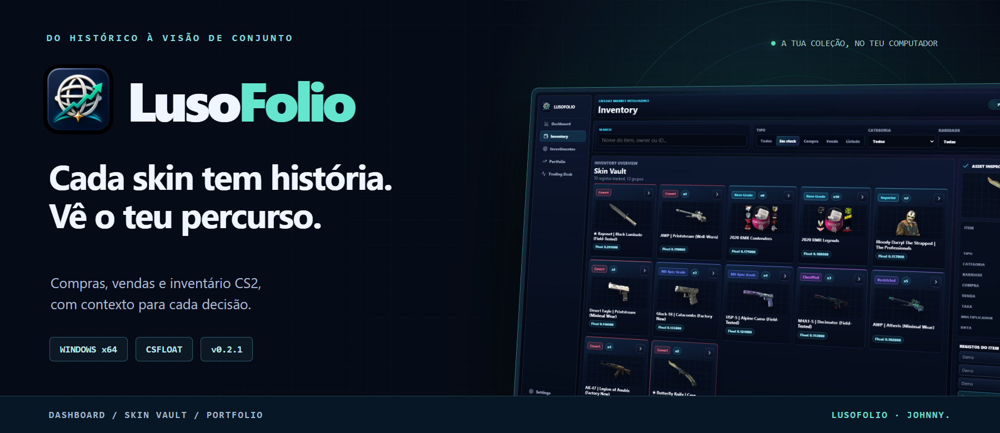
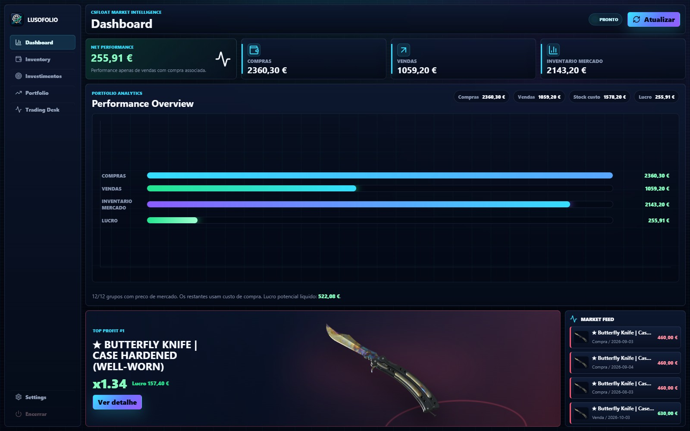
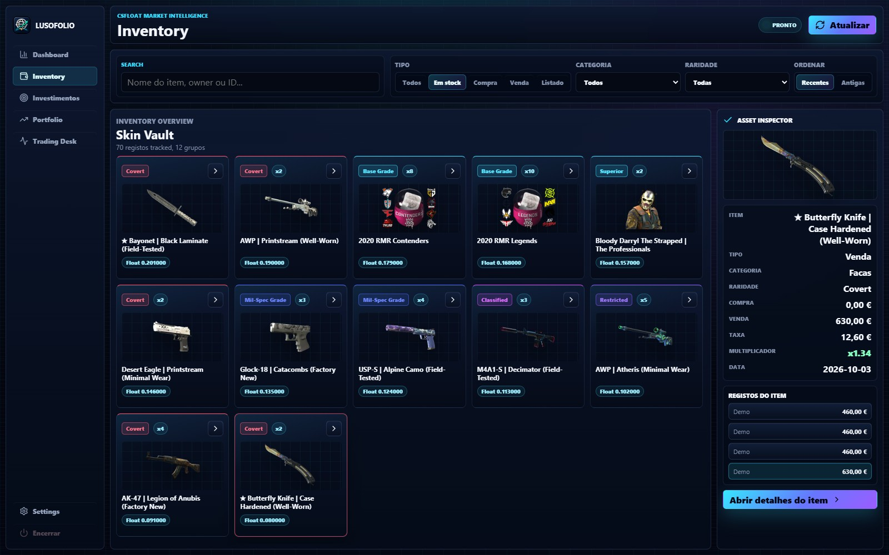
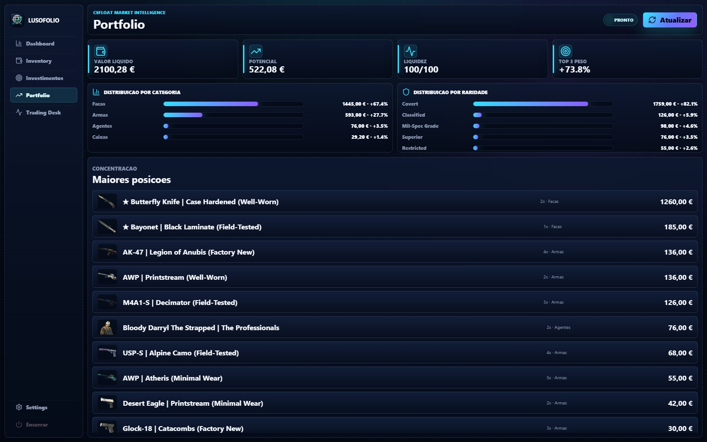
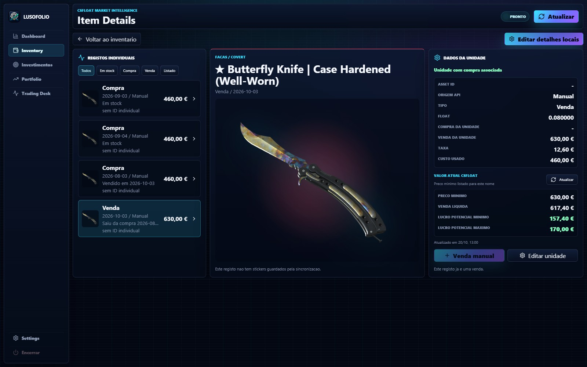
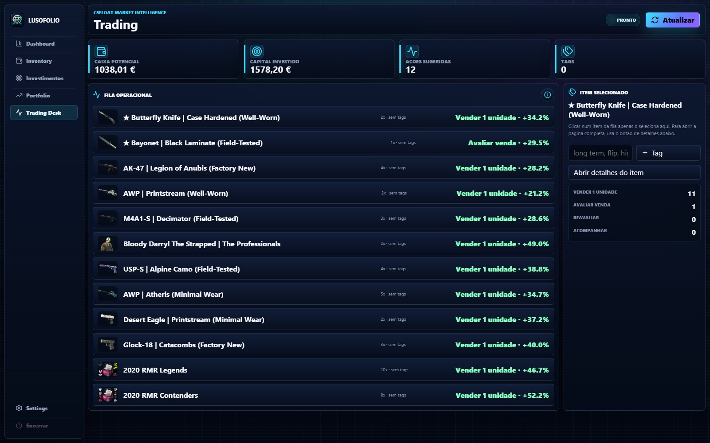

<p align="center">
  
</p>

<div align="center">

# 🌐 LusoFolio

### Cada skin tem história. Vê o teu percurso.

**🪟 Windows x64 · 📦 Versão 0.2.1 · 🎮 CS2 + CSFloat · 💾 Dados locais**

**[⬇️ Descarregar para Windows](https://github.com/Johnnyzao/LusoFolio/raw/refs/heads/main/LusoFolio_0.2.1_x64-setup.exe)**

[📸 Ver a aplicação](#galeria) · [✨ Explorar funcionalidades](#funcionalidades) · [🚀 Instalar](#instalar) · [🔐 Privacidade](#privacidade)

</div>

---

O **LusoFolio** reúne compras, vendas e inventário CS2 numa aplicação Windows. Liga o histórico do CSFloat a uma visão visual das peças: o que compraste, o que vendeste, quanto ficou em stock e como se distribui o teu portefólio.

Dos indicadores do dashboard ao float de uma skin, podes passar da visão de conjunto ao detalhe do item no mesmo espaço de trabalho.

<a name="galeria"></a>

## 📸 Por dentro do LusoFolio

**Interface real, dados de demonstração.** As capturas usam os recursos da aplicação instalada, versão 0.2.1, executados num ambiente local de apresentação com valores fictícios. Não mostram uma conta real nem uma sincronização ativa com o CSFloat.

### 📊 Um dashboard para ligar os números

<p align="center">
  <a href="docs/images/dashboard.jpg"></a>
  <br /><sub>Compras, vendas, inventário e performance de vendas com compra associada. Todos os valores desta galeria são fictícios.</sub>
</p>

### 🎒 Uma coleção que se pode explorar

<p align="center">
  <a href="docs/images/inventory.jpg"></a>
  <br /><sub>Pesquisa, filtros, raridade e float. As unidades agrupadas dão uma leitura mais clara do stock.</sub>
</p>

| 🧭 A composição do portefólio | 🔎 O contexto de cada peça |
| :---: | :---: |
| [](docs/images/portfolio.jpg) | [](docs/images/item-details.jpg) |
| Ver a distribuição e a concentração das posições. | Consultar a peça, o custo e os registos associados. |

<details>
<summary><strong>⚡ Ver também o Trading Desk</strong></summary>



Uma fila operacional para rever peças e organizar tags. As indicações apresentadas são calculadas a partir dos dados disponíveis; este ecrã não envia ordens de compra ou venda.

</details>

<a name="funcionalidades"></a>

## ✨ Da transação à visão de conjunto

| Área | O que podes encontrar |
| --- | --- |
| 📊 **Dashboard** | Indicadores agregados, comparação entre compras, vendas e inventário, destaques de vendas e atividade registada. |
| 🎒 **Inventory / Skin Vault** | Imagens das peças, pesquisa, filtros por tipo, categoria e raridade, agrupamento de unidades e inspetor lateral. |
| 🔎 **Detalhe do item** | Float, raridade, origem, custo de aquisição, notas e contexto dos registos da peça. |
| 🧭 **Portfolio** | Distribuição por categoria e raridade, maiores posições e indicadores de concentração. |
| ⚡ **Trading Desk** | Fila de revisão de peças, tags e indicações calculadas para ajudar a organizar a análise. |

**O contexto dos números importa.** A performance realizada considera vendas com uma compra associada. O valor estimado do inventário depende das cotações disponíveis e da sua atualização; uma estimativa de mercado não equivale a uma venda concluída.

A área **Investimentos** encontra-se em manutenção/standby na instalação observada. Não é apresentada aqui como um sistema de recomendações disponível.

<a name="instalação"></a>
<a name="instalar"></a>

## 🚀 Instalar e começar

### 1. 📦 Descarregar

Descarrega o **[LusoFolio 0.2.1 para Windows x64](https://github.com/Johnnyzao/LusoFolio/raw/refs/heads/main/LusoFolio_0.2.1_x64-setup.exe)**, confirma o hash abaixo e executa o instalador.

🪟 **Requisitos:** Windows 10 ou 11, 64 bits; ligação à Internet e uma conta CSFloat para consultar os teus dados.

<a name="configuração-inicial"></a>

### 2. 🔑 Configurar a tua conta

Na primeira abertura, o LusoFolio pede:

- **API key pessoal do CSFloat**, criada na tua conta, para consultar a informação privada autorizada.
- **SteamID64**, o identificador Steam com 17 algarismos.

O SteamID64 identifica o perfil; não substitui a API key no acesso ao histórico privado. Cada instalação deve usar os dados do respetivo utilizador.

<a name="sincronização"></a>

### 3. 🔄 Importar e explorar

Usa **Atualizar** para pedir os dados do CSFloat. Na instalação observada, as atualizações estão **manuais**, para preservar os limites de pedidos da conta.

Quando precisares de voltar a importar o histórico, consulta a opção **Sincronização completa** nas definições. A disponibilidade dos dados e das cotações depende da API, das permissões e dos limites do CSFloat.

Depois, começa pelo **Dashboard**, explora o **Inventory** e abre uma peça para consultar o respetivo detalhe.

<a name="privacidade"></a>

## 🔐 O teu portefólio fica no teu computador

- 💾 A configuração e a base de dados da aplicação ficam guardadas localmente.
- 👤 Cada instalação mantém os seus próprios dados.
- 🔑 A API key pertence ao utilizador e permite consultar dados privados do CSFloat; não deve ser partilhada ou publicada.
- 🌐 O acesso à conta depende do CSFloat; o LusoFolio não disponibiliza um servidor próprio para guardar o teu portefólio.

As imagens deste README foram preparadas separadamente com dados fictícios, sem publicar a base de dados, a API key ou o identificador Steam de uma conta real.

<a name="verificação-do-instalador"></a>

## 🔎 Verificar a descarga

SHA-256 do ficheiro `LusoFolio_0.2.1_x64-setup.exe` incluído neste repositório:

```text
CF02499224809055F94412EEB8BD73BA70FA463B9797782F607B72189F74165F
```

No PowerShell, na pasta onde guardaste o instalador:

```powershell
Get-FileHash .\LusoFolio_0.2.1_x64-setup.exe -Algorithm SHA256
```

<a name="requisitos"></a>

## 📂 O que este repositório distribui

Este é o repositório de **distribuição da aplicação Windows**: disponibiliza o instalador, a apresentação e as imagens. O código-fonte da aplicação e os dados locais dos utilizadores não fazem parte desta publicação. Não é necessário clonar o repositório nem instalar ferramentas de desenvolvimento para usar o LusoFolio.

<a name="english"></a>

<details>
<summary><strong>🌍 English</strong></summary>

**LusoFolio is a Windows desktop application for tracking CS2 purchases, sales and inventory on CSFloat.** Its dashboard, visual inventory, item details and portfolio views connect transaction history with the composition of your collection.

[Download LusoFolio 0.2.1 for Windows x64](https://github.com/Johnnyzao/LusoFolio/raw/refs/heads/main/LusoFolio_0.2.1_x64-setup.exe), verify the SHA-256 above and complete the setup with your own CSFloat API key and SteamID64. Data is stored locally. The observed installation uses manual updates.

Screenshots show the installed version's interface in a local presentation environment with fictional data. They do not show a real account or a live CSFloat connection. The Investments recommendations area is currently on standby in the observed installation.

</details>

<a name="contactos"></a>

## 🤝 Feito por Johnny

[💻 GitHub](https://github.com/Johnnyzao) · [📷 Instagram](https://www.instagram.com/j0hnny._.zao/)

LusoFolio é um projeto independente, sem afiliação oficial ao CSFloat ou à Valve. CS2, marcas e imagens dos itens pertencem aos respetivos titulares. O ícone original da aplicação foi preservado; a capa combina essa identidade com uma vista de demonstração do produto. [Origem das imagens e âmbito da validação](docs/images/README.md).

---

<p align="center"><strong>🌐 LusoFolio</strong><br /><sub>Cada skin tem história. Vê o teu percurso. ⚡</sub></p>
